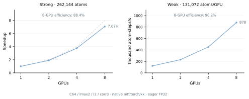
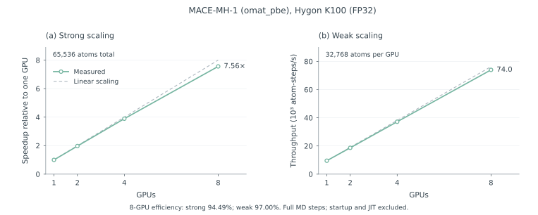
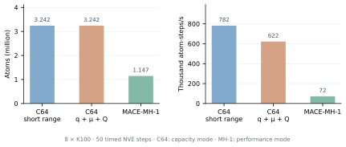
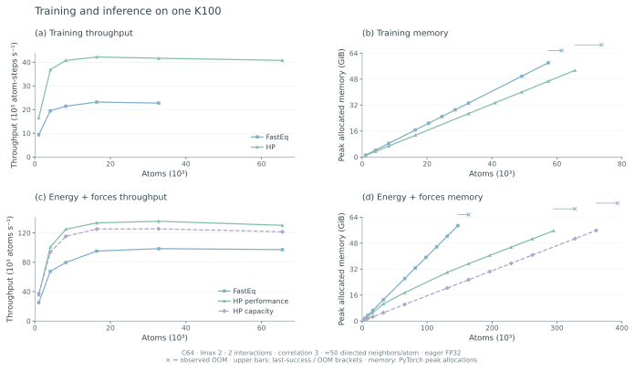
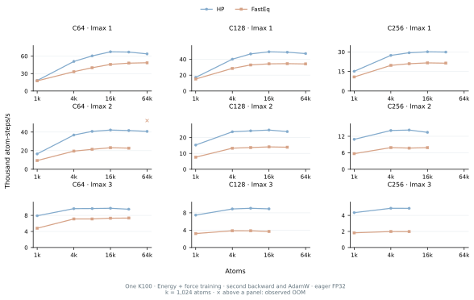
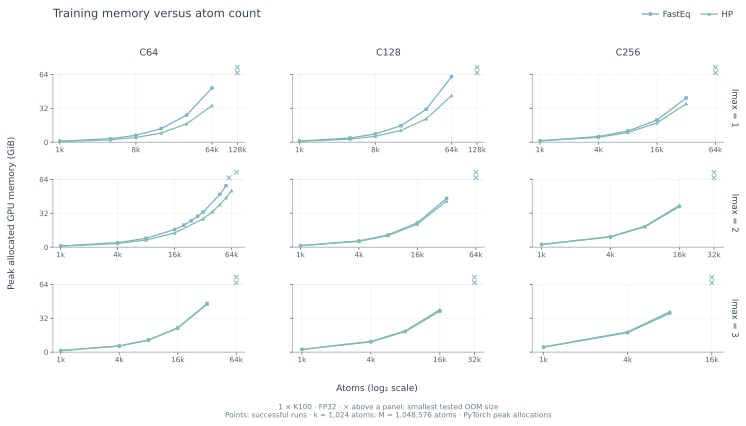
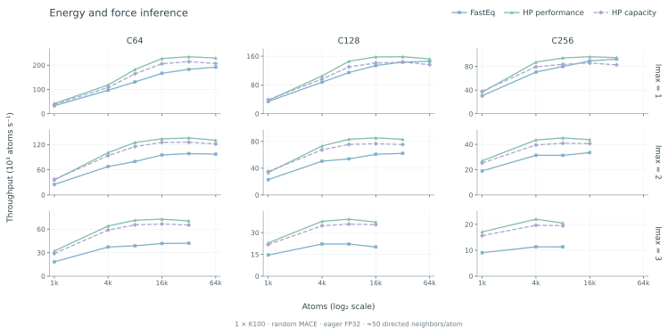
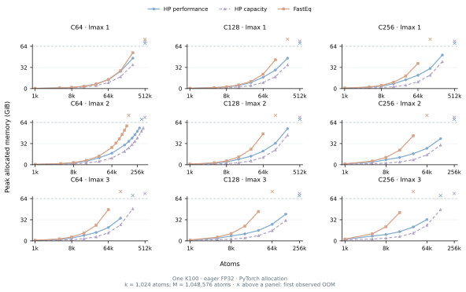
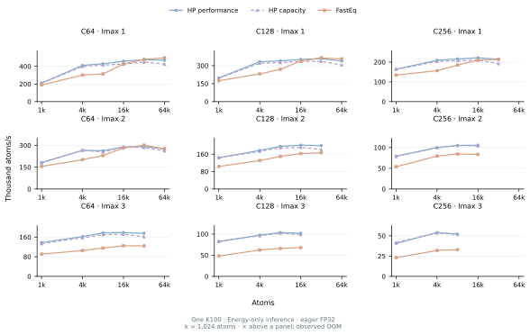
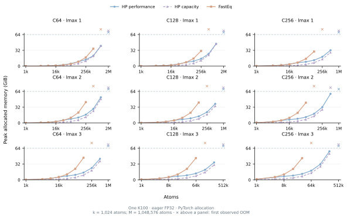

# ICTC-O3-HP-K100

High-performance **ICTC-O3 operators optimized for Hygon K100 GPUs**, together
with the **MACE-ICTC framework** for atomistic modeling, training and inference.

Version **0.1.0**. Distribution: `ictc-o3-hp-k100`.
Python packages: `ictc_o3` for standalone operators and `mace_ictc` for the
MACE-ICTC framework.

## Python API

The two packages live side by side and are installed together:

```text
ictc_o3/          # Public Cartesian tensor operators
mace_ictc/        # MACE-compatible models, training and interfaces
```

```python
from ictc_o3 import (
    EdgeTensorProduct, GraphMessage, PackedGraphMessage,
    direction_harmonics, create_symmetric_contraction,
    configure_symmetric_contraction, channel_linear, normalized_silu,
)
from mace_ictc.hp import create_model, configure_model, energy_and_forces
from mace_ictc.training import ForceTrainer
```

See the [operator API](docs/O3_API.md) for shapes, gradients and standalone usage,
and the [model API](docs/HP_API.md) for training, inference and conversion.
Existing operator imports from `mace_ictc.hp` remain compatible.

## Installation

Use an isolated environment with a compatible K100 vendor PyTorch, HIP/DTK
and Triton stack, then install:

```bash
git clone https://github.com/Parity-LRX/ICTC-O3-HP-K100.git
cd ICTC-O3-HP-K100
python -m pip install -e '.[hp,train,conversion,lammps]'
```

The `hp` extra supplies Ninja and preserves the installed vendor Triton.
GPU execution and just-in-time (JIT) compilation need the matching HIP compiler and runtime.
On Slurm clusters, run computation through `sbatch` on an allocated GPU.

## K100 execution and deployment

The performance path is eager FP32 with native HIP operators for training
and inference. Whole-model `torch.compile`, AOTInductor `.pt2` deployment
and graph replay are outside the supported current K100 workflow.
Native HIP kernel JIT compilation is a separate requirement.

For LAMMPS deployment, `mff-export-core` defaults to native HP performance
inference, and `mff-lammps` enables Kokkos/HIP graph preparation. Multi-GPU
execution exchanges intermediate features and reverse gradients through FP32
RCCL, using a fresh LAMMPS ghost owner map on every force evaluation.

```bash
mff-export-core --checkpoint converted.pth --elements H C O --out core.pt
mpirun --bind-to none -np 8 mff-lammps -in in.mfftorch
```

Run these commands inside a K100 allocation. `--inference-mode capacity`
selects smaller forward chunks; `--backend reference` selects portable
whole-network TorchScript. Build instructions, model packaging and input
examples are in the [K100 MFF-Torch guide](lammps_user_mfftorch/README.md).

## Features

- Tensor products, graph aggregation, direction harmonics and symmetric contractions.
- HIP kernels for first-order backward and mixed second derivatives in energy/force training.
- Streamed inference gates, chunked backward kernels and grouped element-conditioned linear maps.
- Nonlinear MACE-MH-1 conversion with all original readout heads retained.
- Standard MACE conversion preserves radial MLP hidden widths and depth.
- LAMMPS interfaces and model export utilities.

```python
from mace_ictc.hp import create_model, configure_model

model = create_model(channels=64, lmax=2, num_interactions=2, correlation=3)
configure_model(
    model, training=True, policy="generated", layout="fused_pack",
)
```

Generated eager training uses `training_message_linear_layout="node_component"`
by default in both the HP API and `ForceTrainer`/CLI. Set it to `"einsum"` (CLI:
`--training-message-linear-layout einsum`) to select the previous layout.

See the [API guide](docs/HP_API.md) for training, inference and conversion.
The current MH-1 foundation adapter supports frozen-weight force inference;
full MH-1 fine-tuning requires a training adapter.

## Multi-GPU results

Measured on a single node with 64 GiB Hygon K100 GPUs, FP32 arithmetic and
TensorFloat-32 (TF32) disabled. The figures show complete MD step throughput,
including integration, neighbor rebuilding, energy, forces and communication.
Throughput is `global physical atoms / seconds per step`, reported as
atom-steps/s; ghost copies are excluded from the atom count. `k` means thousand.

These measurements use the eager LAMMPS
[ML-IAP](https://docs.lammps.org/pair_mliap.html) interface with FP32 RCCL feature
exchange through dedicated adapters, separate from the generic Python callback.
The public MFF native default packages the same native HP execution and
layerwise transport strategy. The existing figures retain their original
ML-IAP measurement provenance. `.pt2` deployment is unsupported on K100. See the
[LAMMPS guide](lammps_user_mfftorch/docs/BUILD_AND_RUN.md).

The packaged MFF native default is also verified on 1/2/4/8 GPUs. Its 8-GPU
strong/weak efficiencies are 89.21%/90.50% for C64 and
97.96%/98.00% for MH-1. Weak-scaling throughput reaches 882k and 75.3k
atom-steps/s, respectively. See the [MFF measurements and protocol](lammps_user_mfftorch/docs/BUILD_AND_RUN.md#packaged-mff-default-complete-md-steps).

### C64 scaling



C64, hidden/edge `lmax=2`, 2 interactions, full Clebsch–Gordan (CG)
`correlation=3`; randomly initialized H/C/O weights, cutoff 4.5 Å and about
50 neighbors/atom. Grouped element-conditioned linear maps and forward/backward
edge chunks of 1,048,576/32,768. Strong scaling fixes 262,144 atoms; weak
scaling uses 131,072 atoms/GPU with unchanged domain size per GPU.

<details>
<summary>Exact step times, throughput and scaling data</summary>

Strong scaling: fixed total atom count; speedup is the one-GPU time divided by the multi-GPU time.

| GPUs | Global atoms | ms/step | Throughput (atom-steps/s) | Speedup | Efficiency |
| ---: | ---: | ---: | ---: | ---: | ---: |
| 1 | 262,144 | 2,128.899 | 123,136 | 1.000× | 100.00% |
| 2 | 262,144 | 1,125.568 | 232,899 | 1.891× | 94.57% |
| 4 | 262,144 | 566.008 | 463,146 | 3.761× | 94.03% |
| 8 | 262,144 | 301.215 | 870,288 | 7.068× | 88.35% |

Weak scaling: fixed atoms per GPU; speedup is total throughput divided by the one-GPU throughput.

| GPUs | Global atoms | ms/step | Throughput (atom-steps/s) | Speedup | Efficiency |
| ---: | ---: | ---: | ---: | ---: | ---: |
| 1 | 131,072 | 1,055.564 | 124,173 | 1.000× | 100.00% |
| 2 | 262,144 | 1,114.135 | 235,289 | 1.895× | 94.74% |
| 4 | 524,288 | 1,132.590 | 462,911 | 3.728× | 93.20% |
| 8 | 1,048,576 | 1,172.413 | 894,374 | 7.203× | 90.03% |

</details>

### MACE-MH-1 scaling



Pretrained `omat_pbe` head, with all six original heads retained. Periodic
face-centered cubic (FCC) Cu, lattice constant 3.615 Å, cutoff 6 Å and
78 neighbors/atom. Projected-feature FP32 RCCL exchange; forward, backward and
radial edge chunks 262,144/32,768/32,768. Strong scaling fixes 65,536 atoms;
weak scaling uses 32,768 atoms/GPU with unchanged domain size per GPU.
Every GPU count passed 256-atom original-MACE energy/force checks and
per-rank ghost-feature and reverse-gradient communication checks.

<details>
<summary>Exact step times, throughput and scaling data</summary>

Strong scaling: fixed total atom count; speedup is the one-GPU time divided by the multi-GPU time.

| GPUs | Global atoms | ms/step | Throughput (atom-steps/s) | Speedup | Efficiency |
| ---: | ---: | ---: | ---: | ---: | ---: |
| 1 | 65,536 | 6,907.408 | 9,488 | 1.000× | 100.00% |
| 2 | 65,536 | 3,505.261 | 18,696 | 1.971× | 98.53% |
| 4 | 65,536 | 1,774.945 | 36,923 | 3.892× | 97.29% |
| 8 | 65,536 | 913.766 | 71,721 | 7.559× | 94.49% |

Weak scaling: fixed atoms per GPU; speedup is total throughput divided by the one-GPU throughput.

| GPUs | Global atoms | ms/step | Throughput (atom-steps/s) | Speedup | Efficiency |
| ---: | ---: | ---: | ---: | ---: | ---: |
| 1 | 32,768 | 3,437.113 | 9,534 | 1.000× | 100.00% |
| 2 | 65,536 | 3,506.372 | 18,691 | 1.960× | 98.02% |
| 4 | 131,072 | 3,524.422 | 37,190 | 3.901× | 97.52% |
| 8 | 262,144 | 3,543.252 | 73,984 | 7.760× | 97.00% |

</details>

#### MD timing protocol

Scaling was measured with version 0.1.0 on 2026-10-21: one MPI rank and two CPU
threads per GPU, 3 warmup steps and three consecutive 20-step windows. Each
step uses synchronized wall time and the maximum across MPI ranks; the reported
time is the median of the three window means. Startup and JIT compilation are
excluded. Neighbor rebuilding/sorting and release of unused PyTorch allocator
cache are included; the neighbor list is rebuilt every step in these workloads.
The three consecutive windows do not provide a confidence interval from
independent runs.

Strong efficiency is `T₁(N)/(p×Tₚ(N))`; weak efficiency is `T₁(n)/Tₚ(p×n)`, where
`p` is the GPU count, `N` the global atom count, `n` the atoms per GPU and `Tₚ`
the measured step time. C64 means 64 channels per irrep degree; correlation and
interaction depth are separate settings. See the
[API terminology](docs/HP_API.md#terminology-and-notation).

### Eight-GPU capacity



ML-IAP with FP32 RCCL feature exchange; 50 timed microcanonical (NVE) steps
after warmup, 0.25 fs timestep. Times are per-step medians; capacity throughput
is derived from the reported, rounded step times. These are short runs near
the memory limit. Capacity depends on the model, density and neighbor count,
and does not establish long-trajectory stability. The two cases use the model
and material configurations shown above.

<details>
<summary>Capacity measurements</summary>

| Model | Global atoms | Mean neighbors | s/step | Throughput (atom-steps/s) |
| --- | ---: | ---: | ---: | ---: |
| C64 | 3,241,792 | 49.73 | 3.694 | ~877,583 |
| MACE-MH-1 | 1,146,880 | 78 | 16.083 | ~71,310 |

</details>

## Training and inference

HP and FastEq are compared on one Hygon K100 (64 GiB), using complete MACE
models in eager FP32, with TF32 and `torch.compile` disabled. The paired
throughput snapshot dated 21 October 2026 covers 44 configurations:
C64/C128/C256, `lmax=1/2/3`, and 1,024–65,536 atoms, with the tested sizes
varying by architecture. Each pair starts from equivalent randomly
initialized MACE models and uses the same fixed neighbor graph. These
results use two interactions, full CG `correlation=3`, periodic H/C/O,
cutoff 4.5 Å and approximately 50 directed neighbors/atom.



The main panels show C64, `lmax=2`, matching the architecture in the C64
multi-GPU results. The summary ratios below cover the full architecture
scan. Expand the sections for all nine architectures; memory curves extend
through observed OOM, with additional C64/lmax2 samples near the boundary.

### Training

Across 43 paired measurements, the median HP/FastEq training throughput
ratio is 1.65×, with ratios ranging from 1.03× to 2.46×. HP is faster at all
43 paired points and completes all 44 configurations. FastEq runs out of
memory at C64, `lmax=2`, 65,536 atoms.

Each training step includes energy evaluation, forces with
`create_graph=True`, the complete energy-plus-force loss backward with
second derivatives, and an AdamW update. HP uses the default
`training_message_linear_layout="node_component"`.

<details>
<summary>Full training scan: throughput and memory</summary>





The curves include the original successful training points and extensions
at doubled atom counts, through an observed GPU out-of-memory (OOM) result
for each implementation and architecture.

</details>

### Inference

For energy-and-force inference, the median HP/FastEq throughput ratio is
1.40× in performance mode and 1.27× in capacity mode. HP is faster at 44/44
and 41/44 measured points, respectively; FastEq is faster at the remaining
three capacity-mode points.

Performance mode uses a larger forward edge chunk and retains gates for
force evaluation. Capacity mode uses smaller chunks and recomputes gates
to reduce memory use. Both use frozen model parameters and the same FP32
accuracy criteria.

<details>
<summary>Full energy-and-force inference scan: throughput and memory</summary>





</details>

<details>
<summary>Energy-only inference: throughput and memory</summary>



For energy-only evaluation, the median HP/FastEq throughput ratios are
1.26× in performance mode and 1.25× in capacity mode. HP is faster at 38/44
and 34/44 measured points, respectively; some configurations favor FastEq.



Within the original 44-point scan, capacity mode reduces peak allocation
at all 44 points, with a median reduction of 62.7%. Performance mode has a
median increase of 2.9% relative to FastEq.

</details>

### GPU memory versus atom count

Memory curves first extend each preset by doubling the atom count until
GPU OOM. The C64/lmax2 training and energy-and-force curves add three
interior sizes and three bisections of each success/OOM bracket. Curves
stop at the last successful size; crosses above the panels mark only the
atom count of the smallest tested OOM. Upper bars in the main panels show
the refined brackets. These are sampled boundaries, not exact capacity
limits. OOM during initial evaluation or kernel tuning also terminates
a preset. Successful points show peak allocations after warmup.

Within the original matched scan, the median reduction in peak allocated
memory is 12.3% for training, 19.3% for energy-and-force inference in
performance mode, and 60.7% in capacity mode. HP uses less memory at 32/43,
37/44 and 44/44 points, respectively. At the C64, `lmax=2`, 65,536-atom
training point where FastEq runs out of memory, HP uses 53.4 GiB.

Memory values are PyTorch peak allocated GPU memory in GiB, including
resident graph tensors. Driver allocations and external runtime buffers
are excluded.

<details>
<summary>Measurement scope, presets and validation</summary>

Throughput is the number of atoms divided by the optimizer-step or
inference-evaluation time. Ratios are calculated per configuration and
summarized with an equally weighted median. Curves connect measured sizes;
their endpoints do not establish maximum capacity. These random-model
results do not describe pretrained MACE-MH-1.

Training uses 10 warmup steps followed by three 5-step timing rounds.
Inference uses at least three warmup calls and three 10-call rounds;
startup-sensitive cases receive two additional seconds of untimed warmup.
The reported time is the median of the round medians. Model loading,
conversion, compilation, data transfers, neighbor-list construction,
MD integration and multi-GPU communication are excluded. This timing scope
differs from the complete MD steps in the multi-GPU figures above.

The memory extensions retain the same model and preset configurations.
Each new size runs in a fresh process, with two warmup calls followed by
three complete evaluations or optimizer steps; the largest of the three
peak allocations is plotted. Periodic graphs retain the same lattice,
jitter seed and cutoff. Their local stencil construction at larger sizes
matches the complete ASE periodic edge lists at 64, 80, 1,024, 1,280,
4,096 and 5,120 atoms, including non-power-of-two sizes.
The throughput figures use the original 44-configuration timing scan.

The HP inference presets use 81,920/32,768 forward/backward edges per chunk
and a gate-cache budget of 5 GiB per interaction in performance mode;
capacity mode uses 32,768/32,768 edges and no gate cache. These budgets are
not total-model memory limits.

FastEq uses its native HIP tensor-product and symmetric-contraction kernels
within a MACE/PyTorch wrapper. Its force-training path includes a validated
autograd correctness fix. Diagnostic output and diagnostic synchronizations
are disabled; required input-contiguity copies remain inside the timing.

All 44 inference configurations pass initial energy/force checks with
absolute and relative tolerances of `2e-5` and relative L2 error at most
`2e-5`. All nine architectures pass force-loss parameter-gradient and
coordinate-second-derivative checks. Equivalent initial model functions do
not imply identical optimizer trajectories across parameter bases.

</details>

## License

ICTC-O3-HP-K100 is licensed under the [MIT License](LICENSE).
Derived from [ICTC-O3-HP](https://github.com/Parity-LRX/ICTC-O3-HP).
Third-party code retains its original licenses; see
[LICENSE_SCOPE.md](LICENSE_SCOPE.md) and [NOTICE](NOTICE).
Pretrained model weights have their own upstream licenses.
