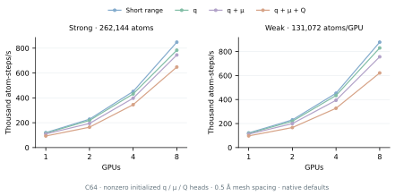
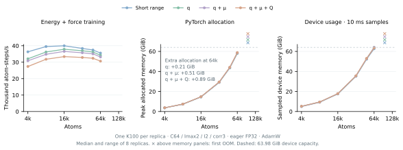
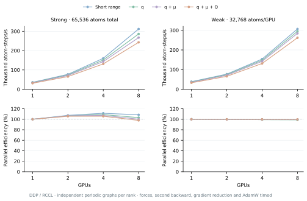

# ICTC-O3-HP-K100

High-performance ICTC-O3 operators optimized for Hygon K100 GPUs, together with
the MACE-ICTC framework for atomistic modeling, energy-and-force training and
molecular dynamics.

Version 0.1.0 · [MIT License](LICENSE) · Distribution: `ictc-o3-hp-k100`

Use `ictc_o3` to build your own equivariant networks, or `mace_ictc` to train,
convert and deploy MACE potentials. The two packages live side by side and ship
in one distribution. Standalone O3 operators run independently of MACE-ICTC.

[Results](#multi-gpu-results) · [Installation](#installation) ·
[O(3) API](docs/O3_API.md) ·
[Training and conversion](docs/USAGE.md) ·
[Electrostatics](docs/ELECTROSTATICS.md) ·
[LAMMPS](lammps_user_mfftorch/README.md) ·
[Architecture](docs/ARCHITECTURE.md)

## Highlights

- Native HIP tensor products, graph messages and symmetric contractions,
  with first derivatives and mixed second derivatives for force-loss training.
- Eight-GPU MD strong scaling: 7.07× speedup for C64/lmax 2 and 7.90× for
  MACE-MH-1, with 88.4% and 98.8% efficiency, respectively. C64 weak scaling
  reaches 878k atom-steps/s at 1,048,576 atoms.
- Large-system MD on eight GPUs: 3,241,792 atoms for C64/lmax 2 with two
  interactions and correlation 3 in capacity mode; 1,146,880 atoms for
  MACE-MH-1 in performance mode.
- MACE conversion, including all six MACE-MH-1 readout heads and its nonlinear
  interactions.
- Learned monopole, dipole and quadrupole reciprocal electrostatics for
  MACE-ICTC training and multi-GPU MD.

The [results below](#multi-gpu-results) give the model configurations,
throughput, memory and measurement protocols. MD throughput counts physical
atoms and includes the complete step: neighbors, energy, forces and communication.

## Installation

Use a Linux environment with Python 3.10 or later and a matching K100
(`gfx926`) vendor PyTorch, HIP/DTK and Triton stack. Install the platform's
PyTorch and Triton first, then add the operator package:

```bash
git clone https://github.com/Parity-LRX/ICTC-O3-HP-K100.git
cd ICTC-O3-HP-K100
python -m pip install -e '.[hp]'
```

The `hp` extra adds Ninja and preserves the installed vendor Triton. Native
HIP kernels compile just in time on first use and require the matching HIP
compiler and runtime. PyTorch spells the K100 HIP device `cuda`.

For dataset preparation, training, conversion and LAMMPS, add:

```bash
python -m pip install -e '.[hp,train,conversion,lammps]'
python -m pip install tables
```

`tables` supplies the preprocessing HDF5 backend; `conversion` adds upstream
MACE, and `lammps` adds `mpi4py`. Build the LAMMPS shared library and Python
bindings separately using the [LAMMPS guide](docs/USAGE.md#9-compile-the-lammps-interface).

Run installation, compilation and computation inside a compute allocation.
On Slurm, submit through `sbatch`; adapt the partition, GPU resource and DTK
module in [`examples/k100_job.sbatch`](examples/k100_job.sbatch) to your site.
The [Slurm setup](docs/USAGE.md#running-on-slurm) covers environment variables
and persistent compilation caches.

## Standalone O3 operators

This complete tensor-product example computes feature, direction and gate
gradients. Run it in the K100 environment on an allocated GPU:

```python
import torch
from ictc_o3 import EdgeTensorProduct, direction_harmonics

channels, lmax, edges = 32, 2, 257
tp = EdgeTensorProduct.create(
    channels=channels, input_lmax=lmax, edge_lmax=lmax,
    output_lmax=lmax, layout="ir_mul", device="cuda",
)
blocks = {
    l: torch.randn(edges, channels, 2*l+1, device="cuda",
                   dtype=torch.float32, requires_grad=True)
    for l in range(lmax+1)
}
vectors = torch.randn(edges, 3, device="cuda", dtype=torch.float32,
                      requires_grad=True)
harmonics = torch.cat(direction_harmonics(
    torch.nn.functional.normalize(vectors, dim=-1), lmax, policy="generated",
), dim=-1)
gates = torch.randn(edges, tp.gate_width, device="cuda",
                    dtype=torch.float32, requires_grad=True)
output = tp(tp.pack_input(blocks), harmonics, gates)
output_blocks = tp.unpack_output(output)
output.square().mean().backward()
```

Channels, angular degrees and edge counts are configurable. The public
[operator API](docs/O3_API.md) also covers graph aggregation, symmetric
contractions, channel linear maps and mesh electrostatics, including tensor
layouts and gradient support. Importing `ictc_o3` alone does not initialize a
GPU or compile extensions. Existing operator imports from `mace_ictc.hp`
remain compatible.

## MACE training, conversion and prediction

Create a model and select native HP training operators:

```python
from mace_ictc.hp import create_model, configure_model

model = create_model(
    channels=64, lmax=2, num_interactions=2, correlation=3, cutoff=4.5,
)
configure_model(
    model, training=True, policy="generated", layout="fused_pack",
)
```

This creates initialized weights. Generated training defaults to
`training_message_linear_layout="node_component"` in the HP API,
`ForceTrainer` and CLI. The [model API](docs/HP_API.md) documents checkpoint
loading, caller-supplied neighbor graphs and `energy_and_forces(..., training=True)`
for force-loss backpropagation.

For a complete training workflow, first [prepare the dataset](docs/USAGE.md#2-prepare-training-data),
including `fitted_E0.csv`, then submit the supplied recipe:

```bash
export ICTC_REPO=/path/to/ICTC-O3-HP-K100
export ICTC_ENV=/path/to/k100-python-environment

sbatch --account=YOUR_ACCOUNT "$ICTC_REPO/examples/k100_job.sbatch" \
  bash "$ICTC_REPO/examples/train_hco.sh" short data/hco models/hco-short.pth
```

`short` disables long-range electrostatics. Replace it with `q`, `qmu` or
`qmuq` to train learned charge, charge/dipole or charge/dipole/quadrupole
sources. The recipe uses C64/lmax 2, two interactions, correlation 3 and a
4.5 Å cutoff; append CLI options to select another configuration.
See the [long-range recipe](docs/USAGE.md#4-train-with-long-range-electrostatics)
for mesh and boundary settings.

Convert an existing torch-saved MACE model using the appropriate route:

```bash
# Ordinary ScaleShiftMACE model.
sbatch --account=YOUR_ACCOUNT "$ICTC_REPO/examples/k100_job.sbatch" \
  mff-convert-mace --mace-model models/source.model \
    --out models/mace-ictc.pth --product-backend ictd-bridge-u \
    --dtype float32 --device cpu

# Nonlinear MACE-MH-1 model; retain all heads and select the default head.
sbatch --account=YOUR_ACCOUNT "$ICTC_REPO/examples/k100_job.sbatch" \
  mff-convert-foundation --mace-model models/mace-mh-1.model \
    --head omat_pbe --out models/mace-mh-1-ictc-hp.pt
```

The [conversion guide](docs/USAGE.md#6-convert-an-existing-mace-model) describes
supported architectures and further training of ordinary converted models.
Use `FoundationHP` for frozen-weight MACE-MH-1 inference, or
[`FoundationTrainHP`](docs/USAGE.md#fine-tune-mace-mh-1-through-ictc) to fine-tune
its original nonlinear architecture with canonical live parameters and FP64
energy reductions.
Evaluate an ordinary trained or converted checkpoint with the supplied example:

```bash
sbatch --account=YOUR_ACCOUNT "$ICTC_REPO/examples/k100_job.sbatch" \
  python "$ICTC_REPO/examples/predict.py" --checkpoint models/mace-ictc.pth \
    --structure data/reference.extxyz --out prediction.json
```

For MACE-MH-1, add `--foundation --head omat_pbe` and use its converted
checkpoint. The [prediction guide](docs/USAGE.md#8-predict-energy-and-forces-with-python)
covers units, neighbors, E0 offsets and supported elements.

## Inference modes and LAMMPS

K100 training and inference use eager FP32 with TF32 disabled and native HIP
operators. Whole-model `torch.compile`, AOTInductor `.pt2` deployment and graph
replay are outside the current supported K100 workflow.

The native LAMMPS exporter defaults to `--inference-mode performance`, using
streamed radial gates and grouped element-conditioned linear maps. Select
`--inference-mode capacity` to bound temporary storage with smaller chunks
and radial rematerialization. Both modes retain the model weights, neighbors
and FP32 arithmetic; their throughput and memory use are reported below.

After [building the interface](docs/USAGE.md#9-compile-the-lammps-interface),
export the deployment bundle inside an allocation:

```bash
mff-export-core --checkpoint models/hco-short.pth --elements H C O --out models/core.pt
```

Keep the four output files together. Start from [`examples/in.hco`](examples/in.hco)
and follow the [one- and eight-GPU launch recipes](docs/USAGE.md#one-gpu-and-eight-gpus).
The `mff-lammps` launcher enables Kokkos/HIP graph preparation for `mff/torch/kk`.
Multi-GPU execution exchanges intermediate features and reverse gradients
through FP32 RCCL, rebuilding the LAMMPS ghost owner map at every force evaluation.
See the [MFF-Torch guide](lammps_user_mfftorch/README.md) for packaging and
interface options, including the plain `mff/torch` path.

## Native long-range electrostatics

`ictc_o3.MeshElectrostatics` exposes standalone monopole (`q`), dipole (`μ`)
and quadrupole (`Q`) operators with configurable source-channel counts,
position and cell gradients, and mixed second derivatives. Learned source
heads integrate the same Gaussian-screened reciprocal correction into
MACE-ICTC training and native `mff/torch/kk` inference, with periodic or
padded-slab boundaries.

Native multi-GPU deployment partitions physical source atoms and FFT slabs
across ranks. Differentiable RCCL exchanges retain both direct electrostatic
forces and the response of learned moments. The optimized message schedule,
real-component multipole contractions and automatic distributed-FFT selection
are enabled by default.

See the [electrostatics API and physical conventions](docs/ELECTROSTATICS.md)
for model configuration, tensor shapes, derivatives and validation.

## Multi-GPU results

Execution uses eager FP32 with TF32 disabled. Each strong- or weak-scaling
series runs on one exclusive eight-GPU node, using 1/2/4/8 active GPUs. The
measured complete MD step includes integration, neighbor rebuilding, energy,
forces, communication and runtime cache handoff. Physical atoms determine
throughput; ghost copies are excluded.

### C64 scaling


The original C64/lmax=2/two-interaction/full-CG correlation=3 H/C/O checkpoint
retains its 64-channel hidden readout, cutoff polynomial parameter `p=6`, radial
MLP widths `[64,64,64]` and 4.5 Šcutoff. Density is 0.125 atoms/ų; the initial
neighbor count is about 50. Strong scaling fixes 262,144 atoms; weak scaling
fixes 131,072 atoms/GPU. The public performance defaults are used throughout.

At eight GPUs, strong scaling reaches 7.07× speedup and 88.4% efficiency. Weak-scaling efficiency is 90.2%, with 878k atom-steps/s.

<details>
<summary>Exact latency, throughput and scaling measurements</summary>

Strong scaling:

| GPUs | Global atoms | ms/step | Atom-steps/s | Speedup | Efficiency |
| ---: | ---: | ---: | ---: | ---: | ---: |
| 1 | 262,144 | 2,185.003 | 119,974 | 1.000× | 100.00% |
| 2 | 262,144 | 1,148.517 | 228,246 | 1.902× | 95.12% |
| 4 | 262,144 | 580.648 | 451,468 | 3.763× | 94.08% |
| 8 | 262,144 | 309.072 | 848,164 | 7.070× | 88.37% |

Weak scaling:

| GPUs | Global atoms | ms/step | Atom-steps/s | Speedup | Efficiency |
| ---: | ---: | ---: | ---: | ---: | ---: |
| 1 | 131,072 | 1,077.001 | 121,701 | 1.000× | 100.00% |
| 2 | 262,144 | 1,137.249 | 230,507 | 1.894× | 94.70% |
| 4 | 524,288 | 1,158.413 | 452,591 | 3.719× | 92.97% |
| 8 | 1,048,576 | 1,194.410 | 877,903 | 7.214× | 90.17% |

</details>

### Long-range scaling



The long-range extensions preserve every short-range checkpoint tensor and add
nonzero initialized source heads. All use one source channel, PCS assignment,
Gaussian width 1 Å and 0.5 Å mesh spacing. The mesh grows with physical volume
in weak scaling. These heads are benchmark extensions, not electrostatically
refitted pretrained potentials. Automatic owner-partitioned source routing and
distributed FFTs use the public defaults, with all communication timed.

| Moments | 8-GPU strong throughput (atom-steps/s) | Strong efficiency | 8-GPU weak throughput (atom-steps/s) | Weak efficiency |
| --- | ---: | ---: | ---: | ---: |
| q | 783,388 | 84.6% | 829,758 | 88.3% |
| q + μ | 745,088 | 84.7% | 756,139 | 84.6% |
| q + μ + Q | 648,038 | 86.8% | 621,525 | 79.8% |

<details>
<summary>Long-range latency and throughput at every GPU count</summary>

#### q

Strong scaling:

| GPUs | Global atoms | ms/step | Atom-steps/s | Speedup | Efficiency |
| ---: | ---: | ---: | ---: | ---: | ---: |
| 1 | 262,144 | 2,265.622 | 115,705 | 1.000× | 100.00% |
| 2 | 262,144 | 1,199.669 | 218,514 | 1.889× | 94.43% |
| 4 | 262,144 | 607.071 | 431,818 | 3.732× | 93.30% |
| 8 | 262,144 | 334.629 | 783,388 | 6.771× | 84.63% |

Weak scaling:

| GPUs | Global atoms | ms/step | Atom-steps/s | Speedup | Efficiency |
| ---: | ---: | ---: | ---: | ---: | ---: |
| 1 | 131,072 | 1,116.359 | 117,410 | 1.000× | 100.00% |
| 2 | 262,144 | 1,194.765 | 219,411 | 1.869× | 93.44% |
| 4 | 524,288 | 1,208.869 | 433,701 | 3.694× | 92.35% |
| 8 | 1,048,576 | 1,263.713 | 829,758 | 7.067× | 88.34% |

#### q + μ

Strong scaling:

| GPUs | Global atoms | ms/step | Atom-steps/s | Speedup | Efficiency |
| ---: | ---: | ---: | ---: | ---: | ---: |
| 1 | 262,144 | 2,384.727 | 109,926 | 1.000× | 100.00% |
| 2 | 262,144 | 1,350.536 | 194,104 | 1.766× | 88.29% |
| 4 | 262,144 | 659.780 | 397,320 | 3.614× | 90.36% |
| 8 | 262,144 | 351.830 | 745,088 | 6.778× | 84.73% |

Weak scaling:

| GPUs | Global atoms | ms/step | Atom-steps/s | Speedup | Efficiency |
| ---: | ---: | ---: | ---: | ---: | ---: |
| 1 | 131,072 | 1,172.882 | 111,752 | 1.000× | 100.00% |
| 2 | 262,144 | 1,312.768 | 199,688 | 1.787× | 89.34% |
| 4 | 524,288 | 1,330.853 | 393,949 | 3.525× | 88.13% |
| 8 | 1,048,576 | 1,386.750 | 756,139 | 6.766× | 84.58% |

#### q + μ + Q

Strong scaling:

| GPUs | Global atoms | ms/step | Atom-steps/s | Speedup | Efficiency |
| ---: | ---: | ---: | ---: | ---: | ---: |
| 1 | 262,144 | 2,810.581 | 93,270 | 1.000× | 100.00% |
| 2 | 262,144 | 1,599.829 | 163,858 | 1.757× | 87.84% |
| 4 | 262,144 | 759.810 | 345,013 | 3.699× | 92.48% |
| 8 | 262,144 | 404.520 | 648,038 | 6.948× | 86.85% |

Weak scaling:

| GPUs | Global atoms | ms/step | Atom-steps/s | Speedup | Efficiency |
| ---: | ---: | ---: | ---: | ---: | ---: |
| 1 | 131,072 | 1,346.530 | 97,341 | 1.000× | 100.00% |
| 2 | 262,144 | 1,572.071 | 166,751 | 1.713× | 85.65% |
| 4 | 524,288 | 1,601.734 | 327,325 | 3.363× | 84.07% |
| 8 | 1,048,576 | 1,687.103 | 621,525 | 6.385× | 79.81% |

</details>

### MACE-MH-1 scaling


The pretrained `omat_pbe` head is selected while all six original heads remain
in the converted model. No electrostatic head is added. The material is periodic
FCC Cu with lattice constant 3.615 Å, a 6 Å cutoff and about 78 neighbors/atom.
Strong scaling fixes 65,536 atoms; weak scaling fixes 32,768 atoms/GPU.
Every GPU count passes original-MACE energy/force checks before and after
motion with atom migration and sorting, plus ghost-feature and reverse-gradient
communication checks.

At eight GPUs, strong scaling reaches 7.90× speedup and 98.8% efficiency. Weak-scaling efficiency is 98.3%, with 75k atom-steps/s.

<details>
<summary>Exact latency, throughput and scaling measurements</summary>

Strong scaling:

| GPUs | Global atoms | ms/step | Atom-steps/s | Speedup | Efficiency |
| ---: | ---: | ---: | ---: | ---: | ---: |
| 1 | 65,536 | 7,008.708 | 9,351 | 1.000× | 100.00% |
| 2 | 65,536 | 3,491.023 | 18,773 | 2.008× | 100.38% |
| 4 | 65,536 | 1,744.131 | 37,575 | 4.018× | 100.46% |
| 8 | 65,536 | 886.747 | 73,906 | 7.904× | 98.80% |

Weak scaling:

| GPUs | Global atoms | ms/step | Atom-steps/s | Speedup | Efficiency |
| ---: | ---: | ---: | ---: | ---: | ---: |
| 1 | 32,768 | 3,433.767 | 9,543 | 1.000× | 100.00% |
| 2 | 65,536 | 3,464.649 | 18,916 | 1.982× | 99.11% |
| 4 | 131,072 | 3,476.302 | 37,704 | 3.951× | 98.78% |
| 8 | 262,144 | 3,491.520 | 75,080 | 7.868× | 98.35% |

</details>

#### MD timing protocol

Scaling timings use three warmup steps followed by three consecutive 20-step
windows. Each step is synchronized and uses the maximum wall time across MPI
ranks; the reported result is the median of the window means. Startup, export
and native kernel JIT are excluded. Timed runs disable atom sorting, rebuild
neighbors every step with a 0.5 Å skin, and start with 300 K Gaussian velocities
(seed 271828) at a 0.25 fs timestep. The allocator uses
`max_split_size_mb:1024`. Consecutive windows are not independent runs.

Strong efficiency is `T₁(N)/(p×Tₚ(N))`; weak efficiency is `T₁(n)/Tₚ(p×n)`.
Throughput is `global physical atoms / seconds per step`.

The 512-atom C64 force checks pass at every GPU count for all moment orders.
An additional 4,096-atom dipole audit gives about `1.09e-5` relative force error
against FP64 in both the old and optimized FP32 implementations. The optimized
version differs from the old native force vectors by at most `4.18e-07` relative L2;
the stricter `1e-6` incremental-error gate passes. The FP64 audit limitation is
retained explicitly; see the [validation details](docs/ELECTROSTATICS.md).

### Large-system runs on eight GPUs


Each point completes one warmup and 50 timed NVE steps at 0.25 fs; the reported
latency is the median step time. These are demonstrated sizes, not an exhaustive
maximum-capacity scan. Device usage is sampled every 10–20 ms and includes
runtime allocations outside PyTorch. The allocated PyTorch peak is reported
separately.

| Model | Mode | Global atoms | s/step | Atom-steps/s | PyTorch peak (GiB/GPU) | Sampled device usage (GiB/GPU) |
| --- | --- | ---: | ---: | ---: | ---: | ---: |
| C64 short range | capacity | 3,241,792 | 4.148 | 781,570 | 33.52 | 59.71 |
| C64 q + μ + Q | capacity | 3,241,792 | 5.213 | 621,882 | 33.53 | 60.43 |
| MACE-MH-1 | performance | 1,146,880 | 15.971 | 71,809 | 58.54 | 63.98 |

The C64 long-range run uses a 592³ reciprocal grid,
initial neighbor count about 49.74 and fixed 0.5 Å mesh spacing. The MH-1 point
uses the unchanged pretrained model and FCC Cu setup above. Short timing runs
do not establish fitted-potential accuracy or long-trajectory stability.

## Long-range training

Remeasured on 2026-10-22 with the README C64/lmax=2/two-interaction/full-CG
correlation=3 checkpoint, including its 64-channel readout and cutoff polynomial
`p=6`. Every learned backbone weight and active electrostatic source head is
trainable; the architecture's fixed TP path constants remain fixed.

### Head overhead and GPU memory



Each point uses one K100 GPU. The four variants use identical backbone weights,
a periodic H/C/O graph with approximately 50 directed neighbors per atom and
4.5 Å cutoff. Long range uses nonzero initialized source heads, one source channel,
PCS, fixed sigma 1.0 Å and three-axis grids at 0.5 Å spacing. These are throughput
fixtures with identical zero energy/force targets, not fitted electrostatic potentials.

One step includes energy, forces with `create_graph=True`, the energy-plus-force
parameter backward with mixed second derivatives, and AdamW (`lr=1e-4`, no weight
decay). Optimizer state is included in memory. Execution is eager IEEE FP32 with
TF32 disabled, without AMP or whole-network compilation. The optimized K100
training schedules use the default `node_component` message-linear layout.

The exact [C64 K100 preset](docs/HP_API.md#c64-k100-training-preset) is documented
separately from the portable API defaults. All measurements use
`PYTORCH_HIP_ALLOC_CONF=max_split_size_mb:1024`.

Eight warmup steps precede three five-step timing windows. Throughput is the
median of eight independent single-GPU replicas on an exclusive node; shading
shows their range. Memory is the largest replica peak. Device usage is sampled
every 10 ms and can miss brief peaks; PyTorch allocation excludes external runtime
and driver memory. Crosses mark the first measured OOM per variant, not a proven
hardware capacity limit. Graph construction, loading and transfers are excluded.

At 65,536 atoms, short-range training reaches 35.6 thousand
atom-steps/s with 57.98 GiB peak allocated memory. Relative to it:

- q: 34.2 thousand atom-steps/s; 3.9% more step time; 58.20 GiB allocated (+0.21 GiB).
- q + μ: 33.2 thousand atom-steps/s; 7.2% more step time; 58.49 GiB allocated (+0.51 GiB).
- q + μ + Q: 30.7 thousand atom-steps/s; 16.0% more step time; 58.87 GiB allocated (+0.89 GiB).

<details>
<summary>Single-GPU training measurements</summary>

| Atoms | Variant | Thousand atom-steps/s | Allocated GiB | Sampled device GiB |
| ---: | :--- | ---: | ---: | ---: |
| 4,096 | Short range | 36.33 | 3.70 | 4.99 |
| 4,096 | q | 32.07 | 3.71 | 5.19 |
| 4,096 | q + μ | 30.87 | 3.73 | 5.19 |
| 4,096 | q + μ + Q | 27.41 | 3.76 | 5.24 |
| 8,192 | Short range | 39.54 | 7.32 | 9.24 |
| 8,192 | q | 36.21 | 7.35 | 9.48 |
| 8,192 | q + μ | 34.81 | 7.39 | 9.47 |
| 8,192 | q + μ + Q | 31.79 | 7.44 | 9.52 |
| 16,384 | Short range | 39.99 | 14.55 | 17.54 |
| 16,384 | q | 37.88 | 14.60 | 17.71 |
| 16,384 | q + μ | 36.56 | 14.68 | 17.79 |
| 16,384 | q + μ + Q | 33.41 | 14.77 | 17.88 |
| 32,768 | Short range | 38.38 | 29.03 | 35.13 |
| 32,768 | q | 36.98 | 29.14 | 35.38 |
| 32,768 | q + μ | 35.74 | 29.29 | 35.51 |
| 32,768 | q + μ + Q | 32.89 | 29.48 | 35.69 |
| 49,152 | Short range | 37.42 | 43.51 | 52.17 |
| 49,152 | q | 36.19 | 43.67 | 52.55 |
| 49,152 | q + μ | 35.07 | 43.89 | 52.69 |
| 49,152 | q + μ + Q | 32.41 | 44.18 | 53.04 |
| 65,536 | Short range | 35.57 | 57.98 | 62.61 |
| 65,536 | q | 34.23 | 58.20 | 63.98 |
| 65,536 | q + μ | 33.19 | 58.49 | 63.98 |
| 65,536 | q + μ + Q | 30.65 | 58.87 | 63.38 |
| 98,304 | Short range | OOM | — | — |
| 98,304 | q | OOM | — | — |
| 98,304 | q + μ | OOM | — | — |
| 98,304 | q + μ + Q | OOM | — | — |
| 131,072 | Short range | OOM | — | — |
| 131,072 | q | OOM | — | — |
| 131,072 | q + μ | OOM | — | — |
| 131,072 | q + μ + Q | OOM | — | — |

</details>

### DDP training scaling



Each DDP rank owns complete, independent periodic graphs. This is data parallel
training, not spatial decomposition of one periodic cell. The measured step
includes RCCL gradient synchronization and AdamW; per-step time is the slowest
rank, and throughput counts all physical atoms in the global batch.

DDP uses ordinary gradient buckets (`gradient_as_bucket_view=False`),
matching the training CLI default. Larger 65,536-atom/GPU short-range
probes reproduce allocator signal failures with both ordinary and view
buckets on this stack. The published weak-scaling comparison therefore
uses the same 32,768-atom/GPU batch for all four variants. Signal failures
are excluded from successful timings and are not labeled as OOM.

Strong scaling fixes 65,536 atoms in 8 graphs of 8,192 atoms.
Weak scaling fixes 32,768 atoms/GPU (4 graphs/GPU). Each series uses one exclusive node
for all GPU counts. All four model variants pass global-batch gradient
comparisons against serial training at every GPU count. Every AdamW update
is checked against its formula, and updated models pass energy/force
comparisons. Neutralization removes the constant monopole source bias;
its tiny FP32 gradient can produce different AdamW bias updates, so parameter
comparisons identify this physical null direction explicitly. Gradient and
energy/force tolerances are retained.

| Variant | 8-GPU strong throughput (k atom-steps/s) | Strong efficiency | Weak throughput (k atom-steps/s) | Weak efficiency |
| :--- | ---: | ---: | ---: | ---: |
| Short range | 311.7 | 108.5% | 306.6 | 99.3% |
| q | 286.0 | 103.1% | 294.7 | 98.9% |
| q + μ | 267.2 | 100.1% | 284.2 | 99.7% |
| q&nbsp;+&nbsp;μ&nbsp;+&nbsp;Q | 242.6 | 97.8% | 262.0 | 99.7% |

Strong-scaling efficiency is end-to-end speedup divided by GPU count; the
measured superlinear cases retain values above 100%. The one-GPU baseline
approaches device capacity and has lower per-atom throughput than the smaller
batches in the atom-count scan. Batch-dependent kernel and memory behavior is
a plausible contributor; these timings do not isolate individual causes. Weak
scaling holds the per-GPU batch fixed and reaches 98.9–99.7% efficiency at eight GPUs.

<details>
<summary>DDP training measurements and per-GPU memory</summary>

| Scaling | GPUs | Variant | Atoms | ms/step | k atom-steps/s | Allocated GiB/GPU | Sampled device GiB/GPU |
| :--- | ---: | :--- | ---: | ---: | ---: | ---: | ---: |
| strong | 1 | Short range | 65,536 | 1824.71 | 35.92 | 57.97 | 62.51 |
| strong | 1 | q | 65,536 | 1888.83 | 34.70 | 58.18 | 63.03 |
| strong | 1 | q + μ | 65,536 | 1963.48 | 33.38 | 58.48 | 63.21 |
| strong | 1 | q + μ + Q | 65,536 | 2114.22 | 31.00 | 58.86 | 63.98 |
| strong | 2 | Short range | 65,536 | 849.10 | 77.18 | 29.02 | 35.29 |
| strong | 2 | q | 65,536 | 885.01 | 74.05 | 29.13 | 35.60 |
| strong | 2 | q + μ | 65,536 | 920.55 | 71.19 | 29.28 | 35.71 |
| strong | 2 | q + μ + Q | 65,536 | 1000.04 | 65.53 | 29.47 | 35.92 |
| strong | 4 | Short range | 65,536 | 409.41 | 160.07 | 14.55 | 17.78 |
| strong | 4 | q | 65,536 | 433.33 | 151.24 | 14.60 | 18.01 |
| strong | 4 | q + μ | 65,536 | 457.44 | 143.27 | 14.68 | 18.09 |
| strong | 4 | q + μ + Q | 65,536 | 499.97 | 131.08 | 14.77 | 18.16 |
| strong | 8 | Short range | 65,536 | 210.25 | 311.71 | 7.32 | 9.46 |
| strong | 8 | q | 65,536 | 229.11 | 286.04 | 7.35 | 9.69 |
| strong | 8 | q + μ | 65,536 | 245.24 | 267.23 | 7.39 | 9.68 |
| strong | 8 | q + μ + Q | 65,536 | 270.09 | 242.64 | 7.44 | 9.74 |
| weak | 1 | Short range | 32,768 | 848.76 | 38.61 | 29.02 | 35.14 |
| weak | 1 | q | 32,768 | 879.50 | 37.26 | 29.13 | 35.46 |
| weak | 1 | q + μ | 32,768 | 919.41 | 35.64 | 29.28 | 35.56 |
| weak | 1 | q + μ + Q | 32,768 | 997.87 | 32.84 | 29.47 | 35.77 |
| weak | 2 | Short range | 65,536 | 852.00 | 76.92 | 29.02 | 35.28 |
| weak | 2 | q | 65,536 | 880.56 | 74.43 | 29.13 | 35.60 |
| weak | 2 | q + μ | 65,536 | 921.87 | 71.09 | 29.28 | 35.71 |
| weak | 2 | q + μ + Q | 65,536 | 998.75 | 65.62 | 29.47 | 35.92 |
| weak | 4 | Short range | 131,072 | 852.43 | 153.76 | 29.02 | 35.31 |
| weak | 4 | q | 131,072 | 886.80 | 147.80 | 29.13 | 35.62 |
| weak | 4 | q + μ | 131,072 | 922.63 | 142.06 | 29.28 | 35.73 |
| weak | 4 | q + μ + Q | 131,072 | 999.52 | 131.13 | 29.47 | 35.94 |
| weak | 8 | Short range | 262,144 | 854.87 | 306.65 | 29.02 | 35.28 |
| weak | 8 | q | 262,144 | 889.49 | 294.71 | 29.13 | 35.60 |
| weak | 8 | q + μ | 262,144 | 922.27 | 284.24 | 29.28 | 35.71 |
| weak | 8 | q + μ + Q | 262,144 | 1000.53 | 262.01 | 29.47 | 35.92 |

</details>

## Training and inference

HP and FastEq are compared on one Hygon K100 (64 GiB), using complete MACE
models in eager FP32, with TF32 and `torch.compile` disabled. The paired
throughput snapshot dated 21 October 2026 covers 44 configurations:
C64/C128/C256, `lmax=1/2/3`, and 1,024–65,536 atoms, with the tested sizes
varying by architecture. Each pair starts from equivalent randomly
initialized MACE models and uses the same fixed neighbor graph. These
results use two interactions, full CG `correlation=3`, periodic H/C/O,
cutoff 4.5 Å and approximately 50 directed neighbors/atom.

These random-model presets differ from the canonical-checkpoint long-range
training preset above. Throughput and memory comparisons apply within each
measurement series.


The main panels show C64, `lmax=2`, matching the architecture in the C64
multi-GPU results. The summary ratios below cover the full architecture
scan. Expand the sections for all nine architectures; memory curves extend
through observed OOM, with additional C64/lmax2 samples near the boundary.

### Training

Across 43 paired measurements, the median HP/FastEq training throughput
ratio is 1.65×, with ratios ranging from 1.03× to 2.46×. HP is faster at all
43 paired points and completes all 44 configurations. FastEq runs out of
memory at C64, `lmax=2`, 65,536 atoms.

Each training step includes energy evaluation, forces with
`create_graph=True`, the complete energy-plus-force loss backward with
second derivatives, and an AdamW update. HP uses the default
`training_message_linear_layout="node_component"`.

<details>
<summary>Full training scan: throughput and memory</summary>


The curves include the original successful training points and extensions
at doubled atom counts, through an observed GPU out-of-memory (OOM) result
for each implementation and architecture.

</details>

### Inference

For energy-and-force inference, the median HP/FastEq throughput ratio is
1.40× in performance mode and 1.27× in capacity mode. HP is faster at 44/44
and 41/44 measured points, respectively; FastEq is faster at the remaining
three capacity-mode points.

Performance mode uses a larger forward edge chunk and retains gates for
force evaluation. Capacity mode uses smaller chunks and recomputes gates
to reduce memory use. Both use frozen model parameters and the same FP32
accuracy criteria.

<details>
<summary>Full energy-and-force inference scan: throughput and memory</summary>


</details>

<details>
<summary>Energy-only inference: throughput and memory</summary>


For energy-only evaluation, the median HP/FastEq throughput ratios are
1.26× in performance mode and 1.25× in capacity mode. HP is faster at 38/44
and 34/44 measured points, respectively; some configurations favor FastEq.


Within the original 44-point scan, capacity mode reduces peak allocation
at all 44 points, with a median reduction of 62.7%. Performance mode has a
median increase of 2.9% relative to FastEq.

</details>

### GPU memory versus atom count

Memory curves first extend each preset by doubling the atom count until
GPU OOM. The C64/lmax2 training and energy-and-force curves add three
interior sizes and three bisections of each success/OOM bracket. Curves
stop at the last successful size; crosses above the panels mark only the
atom count of the smallest tested OOM. Upper bars in the main panels show
the refined brackets. These are sampled boundaries, not exact capacity
limits. OOM during initial evaluation or kernel tuning also terminates
a preset. Successful points show peak allocations after warmup.

Within the original matched scan, the median reduction in peak allocated
memory is 12.3% for training, 19.3% for energy-and-force inference in
performance mode, and 60.7% in capacity mode. HP uses less memory at 32/43,
37/44 and 44/44 points, respectively. At the C64, `lmax=2`, 65,536-atom
training point where FastEq runs out of memory, HP uses 53.4 GiB.

Memory values are PyTorch peak allocated GPU memory in GiB, including
resident graph tensors. Driver allocations and external runtime buffers
are excluded.

<details>
<summary>Measurement scope, presets and validation</summary>

Throughput is the number of atoms divided by the optimizer-step or
inference-evaluation time. Ratios are calculated per configuration and
summarized with an equally weighted median. Curves connect measured sizes;
their endpoints do not establish maximum capacity. These random-model
results do not describe pretrained MACE-MH-1.

Training uses 10 warmup steps followed by three 5-step timing rounds.
Inference uses at least three warmup calls and three 10-call rounds;
startup-sensitive cases receive two additional seconds of untimed warmup.
The reported time is the median of the round medians. Model loading,
conversion, compilation, data transfers, neighbor-list construction,
MD integration and multi-GPU communication are excluded. This timing scope
differs from the complete MD steps in the multi-GPU figures above.

The memory extensions retain the same model and preset configurations.
Each new size runs in a fresh process, with two warmup calls followed by
three complete evaluations or optimizer steps; the largest of the three
peak allocations is plotted. Periodic graphs retain the same lattice,
jitter seed and cutoff. Their local stencil construction at larger sizes
matches the complete ASE periodic edge lists at 64, 80, 1,024, 1,280,
4,096 and 5,120 atoms, including non-power-of-two sizes.
The throughput figures use the original 44-configuration timing scan.

The HP inference presets use 81,920/32,768 forward/backward edges per chunk
and a gate-cache budget of 5 GiB per interaction in performance mode;
capacity mode uses 32,768/32,768 edges and no gate cache. These budgets are
not total-model memory limits.

FastEq uses its native HIP tensor-product and symmetric-contraction kernels
within a MACE/PyTorch wrapper. Its force-training path includes a validated
autograd correctness fix. Diagnostic output and diagnostic synchronizations
are disabled; required input-contiguity copies remain inside the timing.

All 44 inference configurations pass initial energy/force checks with
absolute and relative tolerances of `2e-5` and relative L2 error at most
`2e-5`. All nine architectures pass force-loss parameter-gradient and
coordinate-second-derivative checks. Equivalent initial model functions do
not imply identical optimizer trajectories across parameter bases.

</details>

## License

ICTC-O3-HP-K100 is licensed under the [MIT License](LICENSE).
Derived from [ICTC-O3-HP](https://github.com/Parity-LRX/ICTC-O3-HP).
Third-party code retains its original licenses; see
[LICENSE_SCOPE.md](LICENSE_SCOPE.md) and [NOTICE](NOTICE).
Pretrained model weights have their own upstream licenses.
