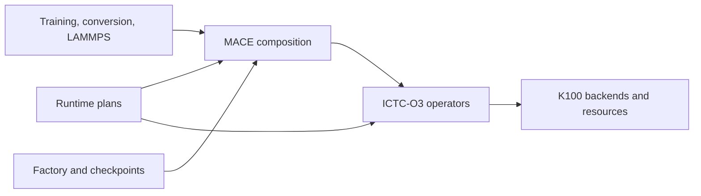

# Architecture

The operator library and the MACE framework share one distribution. Model
construction, checkpoint reconstruction and simulation adapters have separate
entry points so applications do not need to import a training command.

## Model construction and checkpoints

- `mace_ictc.models.factory.build_baseline_model` constructs an untrained backbone.
  The public `mace_ictc.hp.create_model` factory delegates to it.
- `mace_ictc.checkpoints.load_checkpoint` reconstructs trained architecture,
  selects saved weights, restores E0 and applies the requested inference plan.
  It returns a `LoadedPotential`, independent of any simulation engine.
- `mace_ictc.checkpoints.adapters` contains shared force and TorchScript wrappers.
- The training CLI parses arguments and invokes the shared factory. Native MFF
  and both core exporters invoke the shared checkpoint loader.
- Historical CLI factory and MLIAP `from_checkpoint` imports remain compatible.
  Existing checkpoint tensor names, normalization and inference freezing remain
  unchanged.

```python
from mace_ictc.checkpoints import load_checkpoint

potential = load_checkpoint(
    "model.pth", ["H", "C", "O"], device="cuda", operator_plan="checkpoint"
)
model = potential.model
```

`operator_plan="checkpoint"` preserves the checkpoint route. Configure the HP
training or inference plan explicitly when changing the intended execution mode.

## Independent operator implementation

`ictc_o3` owns the operator implementation and never imports `mace_ictc`.

- `basis/` owns Cartesian bases, coupling tensors, frozen angular assets, block
  layouts and fixed representation bridges.
- `ops/` owns tensor products, graph messages, symmetric contractions, channel
  linears and activations.
- `autograd/` owns derivative requirements and rematerialization schedules.
- `backends/k100/` owns HIP/Triton implementations, JIT loading and native sources.
- `electrostatics/` owns reciprocal functionals, mesh assignment and derivatives.

MACE source heads and model-specific long-range assembly remain in `mace_ictc`.
Historical `mace_ictc.models` operator modules resolve to the canonical modules
so released imports and serialized model paths continue to work. There is one
implementation of each operator. Custom-op registration names remain stable.

## MACE composition

`mace_ictc.models.mace` separates model responsibilities:

- `common.py`: initialization, path normalization and feature helpers.
- `layers.py`: element-conditioned linears and interaction layers.
- `products.py`: product-block assembly around shared O3 contractions.
- `heads.py`: energy readouts and the multipole feature contract.
- `backbone.py`: architecture construction and graph orchestration.

The multipole head consumes the final interaction output before the last product
truncates it to scalar features. This retains dipole/quadrupole information for
both one-layer and deeper models. The feature tap returns a view or the existing
tensor without detaching derivatives.

The historical `pure_cartesian_ictd_fix` module resolves to the backbone and
continues to expose its former classes. Parameter attribute paths and
`state_dict` keys are preserved.

## Runtime ownership

`mace_ictc.runtime` owns model-level execution settings and plan selection:

- `config.py` defines `RuntimePlan` and its message, contraction, training,
  inference and electrostatics groups.
- `configure.py` validates settings and binds existing operator schedules before
  evaluation. The public HP keyword API delegates through the same configuration.
- `planning.py` owns MACE coverage checks and backbone operator selection.
- `export.py` and `deployment_sparse.py` own the existing prepared-export paths.

Legacy planning/export module paths remain aliases. Configuration objects carry
settings only; model weights, input tensors and simulation state stay with their
owners. Native MFF retains its performance/capacity policies and transport.
K100 execution remains eager FP32; moving export preparation does not add
whole-model compilation support.


