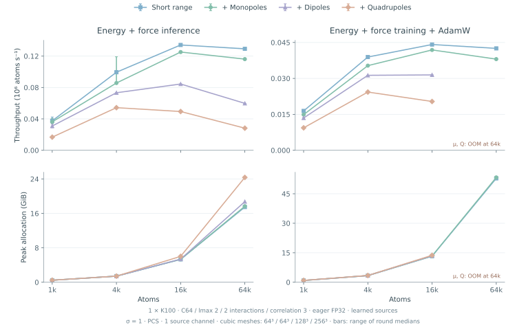
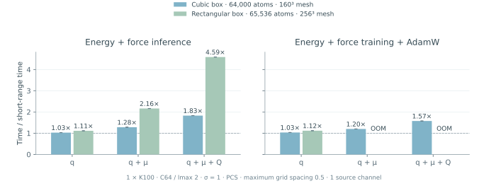
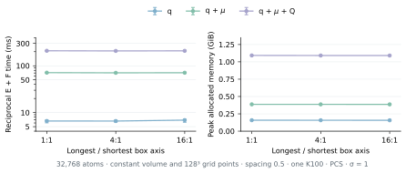
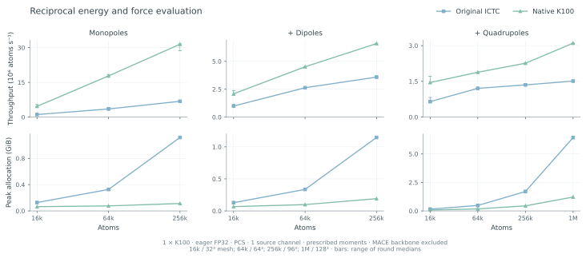
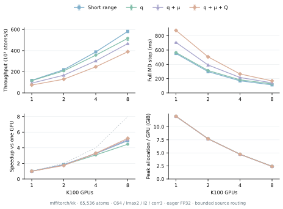
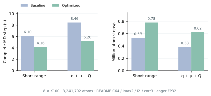

# Native K100 reciprocal electrostatics

The K100 mesh backend accelerates the original ICTC reciprocal functional
for monopoles, Cartesian dipoles and Cartesian quadrupoles. It supports
arbitrary atom counts and positive source-channel counts, CIC/TSC/PCS
assignment, periodic or padded-slab boundaries, batched triclinic cells,
and FP32/FP64 on Hygon K100 (`gfx926`). `mesh_size` accepts a positive
integer for a cubic grid or three positive integers `(Mx, My, Mz)`.

## Fixed physical screening

New `MeshElectrostatics` instances and the `create_model(electrostatics=...)`
factory use `smearing_sigma=1.0`, measured in the same length unit as positions
and cells. Gaussian screening multiplies the reciprocal kernel by
`exp(-sigma**2 * k**2 / 2)`, equivalently `alpha = 1/(sqrt(2)*sigma)`.
The length stays fixed when the box is replicated or strained. It is a model
hyperparameter; changing it after training changes the potential.

Set `smearing_sigma=None` only to reproduce legacy box-dependent screening
(`alpha = 10/L_min`). Existing checkpoint metadata without the new field
retains that legacy rule. Lower-level model constructors and the training
CLI also preserve their old default; pass `long_range_smearing_sigma=1.0`
or `--long-range-smearing-sigma 1.0` to opt in. Fixed screening requires
`mesh_fft` and Gaussian screening enabled (`mesh_fft_full_ewald=True`).
For a bare kernel, use `full_ewald=False, smearing_sigma=None`.

When replicating a periodic cell, increase mesh dimensions by the same factor
to retain physical grid spacing. A fixed mesh size is not a fixed spatial
resolution. Set each axis separately to avoid oversampling shorter lattice
vectors in an elongated box. Converge mesh
resolution for the chosen source ranks and smoothing length. In particular,
high multipole derivatives can amplify mesh aliasing even when energy errors
look small.

Fixed-sigma models retain their reciprocal energy inside exported graphs.
The separate C++ reciprocal solver currently uses legacy box-dependent
screening and a cubic grid. Fixed-sigma or three-axis-grid models therefore
keep their energy inside the graph instead of delegating sources to it.

## Grid selection for rectangular and triclinic cells

```python
from ictc_o3 import MeshElectrostatics, mesh_shape_for_cell

# Setup only: cell rows are lattice vectors, in position units.
shape = mesh_shape_for_cell(cell, spacing=0.5)
solver = MeshElectrostatics(mesh_size=shape, smearing_sigma=1.0, backend="hip").cuda()
# For a 64 x 64 x 128 orthorhombic box, shape is (128, 128, 256).
```

`mesh_shape_for_cell` rounds each lattice-vector length divided by the
requested spacing up to a 2/3/5-smooth FFT size, with a minimum of four.
It accepts `[3,3]` or `[B,3,3]` cells; a batch shares the largest required
size on each axis. Pass the solver's `boundary` and `slab_padding_factor`
to include vacuum padding. Alternatively, pass a mesh tuple directly.
All assignment orders, source ranks, native adjoints and full/reference
FFTs use the three independent sizes, including mixed even/odd axes.

The helper detaches the cell and reads its dimensions on the host. Call it
during initialization, keep the selected mesh fixed during differentiated
energy/force/strain evaluation, and explicitly regrid when needed. Grid
spacing is not an error tolerance. Strongly skewed cells, narrow screening
and higher multipole ranks require their own convergence checks. Changing
grid resolution can change discretization error; it does not change sigma.
The training CLI accepts `--long-range-mesh-size 128,128,256`; checkpoint
and JSON metadata preserve all three sizes. Legacy integer configurations
retain their original meaning.

## Whole-model overhead with fixed screening



These are matched, randomly initialized MACE-ICTC models on one K100, using
C64, lmax=2, two interactions, correlation=3, about 50 neighbors per atom,
eager FP32, PCS, sigma=1 and one learned source channel. The same backbone
weights and graph are used with nonzero source gates. Timings include the
backbone, source prediction and reciprocal module. Training includes the
energy-plus-force loss, mixed second derivatives and AdamW, using the
framework default `loss.backward(inputs=trainable_parameters)`.
Neighbor construction and communication are excluded. Peaks are PyTorch
allocated memory, excluding driver and external runtime buffers.

The overview uses 64³ grids at 1,024 and 4,096 atoms, 64×128×128 at
16,384 atoms, and 128×128×256 at 65,536 atoms. The two larger sizes were
remeasured with three-axis grids; the two smaller points retain the
qualified cubic-grid measurements. Three synchronized timing rounds follow
compilation and warmup. Error bars show the range of round medians, rather
than confidence intervals.

### Removing short-axis oversampling



For 65,536 atoms in a 64×64×128 box, replacing 256³ with 128×128×256
removes three quarters of the grid points. The maximum lattice step remains
0.5; the shorter axes change from 0.25 to 0.5. With the same models and graph:

- Monopoles: energy-and-force inference 564 → 519 ms; training 1734 → 1603 ms.
- Adding dipoles: inference 1096 → 647 ms; training OOM → 1872 ms.
- Adding quadrupoles: inference 2322 → 927 ms, a 2.50× throughput increase.
  Peak inference allocation falls from 24.37 to 18.23 GiB. Training changes
  from OOM to 2458 ms and 53.87 GiB peak allocation.

The short-range backbone takes 503 ms for inference and 1549 ms for training.
With the rectangular grid, time increases for the three source ranks are
3.2%, 28.7% and 84.4% for inference; 3.5%, 20.9% and 58.7% for training.
Quadrupole throughput is 70.7 thousand atom-steps/s for inference and
26.7 thousand for training. OOM denotes failure with the default PyTorch
allocator, not a proven hardware capacity bound.

At 16,384 atoms, changing 128³ to 64×128×128 reduces quadrupole inference
from 332 to 232 ms and training from 803 to 596 ms. These endpoints do not
establish a maximum system size. Overhead also depends on backbone cost,
source width, source rank, screening and mesh resolution.

### Cost at fixed volume and resolution



The standalone scan holds 32,768 atoms, physical volume, spacing 0.5,
PCS, sigma=1 and the total grid-point count (128³) fixed. The boxes are
64×64×64, 32×64×128 and 16×64×256, with respective meshes
128×128×128, 64×128×256 and 32×128×512. Only prescribed sources and the
reciprocal energy/force calculation are timed; no backbone is included.

Across longest/shortest axis ratios of 1, 4 and 16, quadrupole evaluation
takes 209.1, 207.6 and 208.5 ms. Dipole timings are 71.3, 70.6 and 71.0 ms.
Peak allocation is approximately 1.09 GiB for quadrupoles in all three cases.
The cubic-grid oversampling penalty is removed for these shapes. Vendor FFT
factorization and skewness can still affect cost; this scan does not prove
identical performance for every possible cell.

### Accuracy when changing grids

Native and reference implementations agree on the same three-axis grid
through mixed second derivatives. Regridding changes discretization error,
so the speedup is not a claim of bitwise equivalence to a larger cubic grid.
In the 65,536-atom random-model comparison, the largest total-force relative
L2 difference is `4.5e-5`, with maximum absolute difference below `2e-6`.
For the monopole-only long-range force, the relative L2 difference is
approximately 0.28%. The randomly initialized multipole sources are small;
total-force agreement alone cannot certify long-range accuracy for a
trained potential. Independent continuous structure-factor checks verify
mesh convergence separately. Select spacing for the required force/stress
accuracy, retaining sigma and the trained source conventions.

## Assignment implementation benchmark



For 1,048,576 atoms with monopoles, dipoles and quadrupoles on a 128³ mesh,
energy-and-force evaluation takes 694 → 338 ms. Peak PyTorch allocation
falls from 6.43 to 1.22 GiB. At 262,144 atoms on a 96³ mesh, the corresponding
monopole evaluation takes approximately 38 → 8 ms. At the same size, a
monopole energy-plus-force loss backward and AdamW source update takes
75 → 27 ms; with dipoles and quadrupoles it takes 399 → 266 ms.

These measurements isolate the reciprocal module with one prescribed
source channel, eager FP32 and TF32 disabled. Source prediction, the MACE
backbone, neighbor construction and multi-GPU communication are excluded.
This compatibility benchmark uses legacy box-dependent screening
(`smearing_sigma=None`), rather than the new fixed-length factory default.
The curves connect measured sizes; endpoints do not establish capacity
limits. Error bars show timing variation, rather than confidence intervals.
Smaller workloads show more host-timing variation.

## Validation

Fixed-length screening is checked separately from implementation parity:

- Two physical lengths and all three source ranks agree with the full-FFT
  reference through mixed second derivatives. Mesh refinement is compared
  with an independent continuous structure-factor calculation.
- Eightfold periodic replication preserves energy per cell and per-atom
  forces at identical physical grid spacing. Three FP32 whole models with
  two source channels also preserve the cell virial, with relative errors
  below `1.1e-6`; force differences are below `3.4e-6`.
- Nine strain components pass independent FP64 finite differences, including
  cubic cells with equal lattice-vector lengths.
- Far-field forces for q–q, q–mu, q–Q, mu–mu, mu–Q and Q–Q recover their
  expected distance powers and signs. At sigma=1, a 96-unit periodic box
  and a 192³ PCS mesh, the largest discrepancy from the isolated asymptote
  over separations 6, 9 and 12 is below 0.86%. This includes periodic-image
  effects and is not a universal error guarantee.
- Fixed-length and legacy checkpoints reload their respective screening
  rules. Whole-model energy/force/virial-loss parameter gradients match the
  Torch reference for monopole, dipole and quadrupole heads.

Rectangular-grid validation adds:

- 24 assignment/adjoint cases covering both precisions, layouts, all three
  assignment orders, periodic/slab boundaries and an empty graph member.
- 24 full-spectrum FFT comparisons with mixed even/odd axes, triclinic
  cells, screened/bare and Poisson/learned-Poisson kernels, and all ranks.
  These include first and mixed second derivatives.
- Independent structure-factor convergence, finite-difference first/second
  derivatives, and anisotropic 1×2×3 replication for all three source ranks.
- Three whole-model energy/force/virial-loss gradient comparisons and
  checkpoint round trips with nondefault source widths. Batched-cell FX
  capture, CLI parsing and six export-metadata configurations also pass.

The earlier cubic-grid K100 validation covers 12 assignment cases, 14 electrostatics configurations,
24 full-spectrum FFT comparisons, three whole-model energy/force/stress-loss
gradient comparisons, and scalar/multipole checkpoint round trips with
nondefault source widths and correlation. Tests include FP32/FP64,
CIC/TSC/PCS, odd meshes, triclinic and padded-slab cells, empty atoms and
empty graph members. Independent finite differences check first and mixed
second derivatives. Channel-first adjoints, graph-capture fallback and
deterministic-execution guards are checked separately.

FP32 comparisons against an FP64 oracle use relative L2 error at most
`2e-5` and maximum absolute error at most
`2e-5 * max(1, max(abs(reference)))`. FP64 comparisons use elementwise
absolute/relative tolerance `2e-8`. Near-cancelling FP32 cell-gradient
components also vary between repeats of the original atomic-reduction
implementation. The million-atom force comparison has relative L2 error
approximately `1.7e-6` for both the original and native FP32 implementations.

## Standalone operator

```python
import torch
from ictc_o3 import MeshElectrostatics

solver = MeshElectrostatics(
    mesh_size=64, assignment="pcs", boundary="periodic",
    neutralize=True, full_ewald=True, smearing_sigma=1.0, backend="hip",
).cuda()

# positions: [N,3]; batch: int64 [N]; cell: [B,3,3], lattice vectors in rows.
# q: [N,S]; mu: [N,S,3]; Q: [N,S,3,3]. Omit mu/Q for monopoles.
positions = positions.requires_grad_(True)
atom_energy = solver(positions, batch, cell, q, dipole=mu, quadrupole=Q)
energy = atom_energy.sum()
forces = -torch.autograd.grad(energy, positions, create_graph=True)[0]
loss = (energy - target_energy).square() + (forces - target_forces).square().mean()
loss.backward()
```

Inputs share a floating dtype and device. Use `solver.double()` with FP64
inputs. Scalar sources are neutralized per graph; dipoles and quadrupoles
are not neutralized. Empty inputs and empty graph-batch members are
supported. Scalar energies use the requested `energy_partition`; multipole
energies are partitioned uniformly over each graph's atoms.

Positions, moments, learned Green-filter parameters and cells remain
differentiable. Cell derivatives support strain-based stress evaluation
with the application's sign and volume convention. Native backward and
mixed second derivatives cover energy-plus-force training. For third and
higher derivatives, select `backend="reference"`.

Low-level assignment and its adjoint are also public:

```python
from ictc_o3 import mesh_spread, mesh_gather

mesh = mesh_spread(
    fractional_positions, batch, source,
    mesh_size=64, num_graphs=num_graphs, assignment="pcs", backend="hip",
)
sampled = mesh_gather(
    fractional_positions, batch, mesh,
    mesh_size=64, num_graphs=num_graphs, assignment="pcs", backend="hip",
)
```

The default mesh layout is `[B,Mx,My,Mz,C]`. `channels_first=True` uses
`[B,C,Mx,My,Mz]`. Fractional coordinates follow the original boundary
preparation: `slab` wraps x/y and clamps z mesh indices after vacuum padding.

## Learned MACE-ICTC model

```python
from mace_ictc.hp import create_model, configure_model

model = create_model(
    channels=64, lmax=2, num_interactions=2, correlation=3,
    electrostatics={
        "mesh_size": 64, "source_channels": 2,
        "max_multipole_l": 2,  # 0: monopoles; 1: add dipoles; 2: add quadrupoles
        "assignment": "pcs", "smearing_sigma": 1.0,
    },
)
configure_model(
    model, training=True, policy="generated", layout="fused_pack",
    electrostatics_backend="hip",
)
```

`electrostatics=None` preserves the short-range factory behavior. A mapping
enables `reciprocal-spectral-v1` with a periodic mesh, Gaussian screening
at a fixed length of 1.0 and reciprocal-only energy by default. It accepts the original long-range
factory options without the `long_range_` prefix. `max_multipole_l` must not
exceed the backbone `lmax` or 2. Equivariant readouts and channel mixers
remain trainable. The scalar energy gate starts at zero; the multipole
source gate starts at 0.1.

Existing modules and checkpoints can select execution explicitly:

```python
from mace_ictc.hp import configure_electrostatics

configure_electrostatics(model, backend="hip", fuse_multipole_fft=True)
configure_electrostatics(model, backend="reference")
```

`auto` selects native assignment on K100 FP32/FP64 and the Torch reference
elsewhere. `hip` rejects unsupported devices/dtypes when evaluated.
Configuration does not freeze parameters, cast tensors or compile kernels.
`configure_model(policy="reference")` restores reference electrostatics;
export preparation selects reference mesh operations for graph capture.
The HIP extension is compiled lazily during eager execution.

The training CLI also accepts `--long-range-mesh-fft-reciprocal-only`.
Together with `--long-range-mesh-fft-full-ewald`, it selects the screened
reciprocal functional. This flag is saved and restored in checkpoint
metadata. A missing flag retains the existing K100 checkpoint default;
runtime backend choices add no state-dict parameters.
`long_range_smearing_sigma` is saved and restored alongside these options.
`ForceTrainer(..., config=cfg, electrostatics_backend="hip")` and CLI
`--electrostatics-backend hip` explicitly require the eager K100 backend.
Pass the matching `ModelConfig` to the trainer when writing checkpoints.

## Functional and implementation

With hats denoting assigned-grid Fourier transforms:

```text
S(k) = q_hat(k) + i k · mu_hat(k) - 1/2 k · Q_hat(k) · k
E    = 1/(2V) sum_{k != 0, channels} G(k) |S(k)|² / |W(k)|²
```

`G(k)` is the original Poisson or learned Poisson kernel with configured
Gaussian screening. `W(k)` is the matching B-spline assignment window.
FFT normalization, quadrupole sign/factor, neutralization and graph
partitioning follow the original ICTC implementation. No additional
Coulomb unit-conversion constant is inserted; sources and prefactors use
the caller's unit system.

The forward Fourier transform uses `exp(-i*k.r)`, and the API preserves the
original `+i*k.mu` source convention. If standalone sources represent a
physical point-dipole density `-p.grad(delta)`, pass `dipole=-p`. The quadrupole
term uses the Cartesian second-moment convention shown above, with its factor
of one half. Learned source heads fit these conventions during training.

HIP kernels calculate weights and derivatives while loading atoms,
avoiding `[N,stencil,C]` source/gradient temporaries. Their adjoints include
coordinate Hessian-vector products and source/mesh cross terms. The
multipole path can spread all components once and use one real-FFT batch.
Both folded mirror wavevectors are retained at Nyquist boundaries, so
triclinic cells and unscreened kernels preserve the full-spectrum functional.
FFTs use PyTorch's vendor HIP FFT backend. Live inputs, topology, moments,
cell-dependent spectral weights and learned parameters are not cached.
Floating atomic reductions are not bitwise deterministic.

This API implements a screened reciprocal correction. Full fixed-charge
Ewald additionally requires real-space, self and background terms. The
existing scalar exact-Ewald option retains its reference real-space path;
this change does not accelerate that dense pairwise calculation. Padded
slab boundaries retain the original approximation, rather than an exact
two-dimensional Ewald sum. Mesh resolution and padding need physical
convergence checks. Only the legacy `smearing_sigma=None` estimate uses the
shortest periodic lattice vector and has a nondifferentiable minimum at tied
shortest lengths. Fixed-sigma screening removes that minimum from the
reciprocal energy.

The standalone API supplies each physical atom once on one device.
Independent-graph DDP can use a local mesh per rank. Native MFF additionally
supports a domain-decomposed graph through the global reductions below.

## Native LAMMPS `mff/torch/kk`

The native MFF interface from `main` loads learned reciprocal models through
the same public export and launch commands as short-range models:

```bash
# Inside a scheduled K100 allocation, using a checkpoint with trained
# long-range heads and the chosen physical screening/grid resolution:
mff-export-core --checkpoint electrostatic.pth --elements H C O --out core.pt
mpirun --bind-to none -np 8 mff-lammps -in in.mff
```

```lammps
units metal
atom_style atomic
atom_modify map array
boundary p p p
read_data system.data
neighbor 0.5 bin
pair_style mff/torch/kk 4.5 cuda
pair_coeff * * core.pt H C O
thermo 1
thermo_style custom step pe fmax
run 0
```

Use the checkpoint's element mapping, cutoff and units. Keep the native
archive and its `.checkpoint.pth`, `.json` and `.meta` sidecars together.
The JSON records mesh dimensions, assignment, screening and the native
reciprocal transport. The public MFF bootstrap registers the installed HIP
runtime and evaluates the complete reciprocal contribution inside autograd.

Each rank predicts moments only for its owned prefix. Global charge
neutralization uses the physical atom count and a summed owned charge.
Owned sources and fractional coordinates are routed only to the x slabs touched
by their B-spline stencil. Native HIP assignment writes directly into the local
slab, retaining the global mesh spacing and derivatives. Local y/z real FFTs,
an all-to-all transpose into y slabs, and local x FFTs distribute the spectral
work. Multipoles sum local spectral energies. Scalar potentials additionally
use distributed inverse FFTs; partial stencil potentials return to their atom
owners, preserving the original per-atom energy partition.

Quadrupoles use the six exact combinations
`Qxx, Qyy, Qzz, Qxy+Qyx, Qxz+Qzx, Qyz+Qzy` with coefficients
`kx², ky², kz², kx*ky, kx*kz, ky*kz`. This removes three FFT fields per source
channel without assuming symmetry or a zero trace. The single-GPU native MFF
path uses the same compact representation. Both folded Nyquist partners remain
explicit for triclinic or mixed even/odd grids. Uneven slabs use padded
communication buffers; physical FFT dimensions remain unchanged.

The reverse slab/charge collectives and the main interface's reverse
feature exchanges retain both direct electrostatic forces and the response
of learned moments to geometry. LAMMPS reverses ghost-coordinate forces to
their owners. Ghost copies never enter the global source sum; the current
owner map and source values are rebuilt after migration and sorting.

The supported MFF scope is one node, one rank per K100, a single communicator
and nonempty owned domains, matching the native `main` interface. Multipole
FFTs and spectral geometry are partitioned across ranks when the mesh y axis
has at least as many points as the process group. The default `auto` policy
requires at least 1,048,576 real mesh values across source channels and packed
Cartesian components for multipoles. Scalar potentials use a higher threshold
of 8,388,608 values because they need inverse transforms and a potential return
exchange. Smaller work, smaller y axes and single ranks use the replicated
path. `ICTC_MFF_MULTIPOLE_FFT=particles` bypasses the work threshold;
`slabs` selects the previous full-mesh reduce-scatter implementation, and
`replicated` selects the original Fourier-amplitude reduction path.
The communication adjoints support mixed second derivatives. The routed path
allocates neither a full real-space mesh, a full assignment window nor a global
atom/source array on any rank.

Native `capacity` mode additionally recomputes frozen radial MLP activations
during coordinate backpropagation. Forward evaluation and the coordinate VJP
use chunks of 32,768 edges, bounding temporary hidden activations for arbitrary
radial widths and depths. The full radial output required by the message
operator is retained. Only local radial operations are replayed; feature and
reciprocal collectives execute once in each direction. Parameters, model
equations and FP32 arithmetic are retained. The `performance` mode keeps
these activations to avoid the recomputation cost. Trainable radial parameters
retain the existing autograd/checkpoint path.
Capacity mode also limits message blocks to at most 32,768 edges. Both modes
apply a memory budget based on tensor-product path width, so wide models can
use smaller blocks. Performance mode allows larger blocks within that budget.
This bounds message-expansion temporaries while retaining all neighbors.
Once the observed PyTorch allocation peak exceeds 75% of device memory,
capacity mode also synchronizes between force graphs and reclaims completed
Python wrappers and idle allocator blocks before the next graph. This limits
the effect of changing neighbor counts on large temporary allocations. Its
cost is included in the capacity-mode MD timings.

Select this mode when exporting the native core:

```bash
mff-export-core --checkpoint electrostatic.pth --elements H C O \
  --inference-mode capacity --out core-capacity.pt
```

Full real-space Ewald, dispersion,
multi-node operation, pressure/NPT and long-trajectory stability are outside
this qualification; the existing Kokkos virial flag remains unchanged.


### Multi-GPU scaling at 65,536 atoms



One K100 node, one rank per GPU, C64/lmax=2/two interactions/correlation=3,
factory initialization with a 16-channel hidden readout and cutoff polynomial
parameter `p=5`, 65,536 atoms, about 50 neighbors per atom, PCS, sigma=1, one source channel
and a 128×128×256 mesh. Models are randomly initialized with a nonzero
long-range contribution. Timings include the complete MD step, neighbor
rebuilding on every step and all communication. The median of three
five-step means follows three warmup steps; bars show the range of means.
Compilation and export are excluded. Execution is eager FP32 with TF32 off.
The dashed line denotes ideal strong scaling.
This experiment uses its own fixed model and geometry. The capacity results
below use the original README checkpoint, a 64-channel hidden readout and
cutoff polynomial parameter `p=6`; their absolute timings should be interpreted
with that configuration.
These scaling measurements precede the large-system CSR and spectral
contraction optimizations described below.
Only the unchanged short-range series retains earlier measurements. Scalar
and multipole paths were remeasured; the single-GPU quadrupole baseline uses
the same six-component representation as the distributed path.

- Monopoles: 566 → 127 ms/step from one to eight GPUs, 4.46× speedup and
  55.7% parallel efficiency. Eight-GPU throughput is 516,000 atom-steps/s.
- Adding dipoles: 707 → 140 ms/step, 5.04× speedup and 63.0% efficiency.
  Eight-GPU throughput is 467,000 atom-steps/s.
- Adding quadrupoles: 876 → 168 ms/step, 5.21× speedup and 65.1% efficiency.
  Eight-GPU throughput is 390,000 atom-steps/s. Maximum per-rank PyTorch
  allocation falls from 12.01 to 2.41 GiB; external runtime buffers are excluded.
- The matched short-range backbone takes 552 → 112 ms/step, 4.91× speedup.

In a same-job eight-GPU control, full-mesh slab assignment takes 207.25 ms/step
versus 168.14 ms/step with bounded source routing, a 1.23× improvement. A
single-GPU control improves from 981.57 to 875.65 ms/step using the compact
quadrupole representation. The original replicated eight-GPU FFT path took
540 ms/step. These results cover the fixed global grid above; they do not
imply ideal scaling for arbitrary mesh aspect ratios or source counts.

Validation uses separate C8/lmax=2/two-interaction/correlation=1 models,
two source channels and a 16×20×24 mesh in a triclinic periodic cell.
All three moment orders pass at 1/2/4/8 GPUs before and after motion and
sorting; every multi-GPU dense case exercises owned-atom migration. Complete force vectors agree with the same-model,
same-grid Torch reference within `6.4e-6` relative L2 and `1e-6` maximum
absolute error. Eight-GPU mixed isolated/connected-domain cases also
pass. The long-range force change is of the same order as the total force
in these checks, so zero-initialized heads cannot hide a missing contribution.

An independent 48-case source/partition/mesh/rank/constant-domain check matches
FP64 reference forces and mixed second derivatives, including slab boundaries,
odd dimensions, uneven slabs and the small-axis fallback. Nine direct
distributed-FFT checks additionally verify spectra, adjoints and mixed
Hessians with multiple batches/channels and axes shorter than the rank count.
These checks include both forward and inverse distributed transforms. A
24-case native assignment check verifies bounded x slabs, both channel layouts,
CIC/TSC/PCS, periodic/slab boundaries and mixed second derivatives. Capacity
mode also passes 1/2/4/8-GPU whole-model force checks with radial recomputation.
Eight direct frozen-radial checks cover multiple widths and depths, hidden and
full outputs, biases, coordinate VJPs and mixed second derivatives; a separate
trainable-parameter check verifies the fallback path.
Deliberately detaching
geometry-dependent moments produces large force errors, confirming that
source response is exercised. The default automatic policy is checked on
both the small qualification grid and the large performance grid. The public
`mff-lammps` bootstrap additionally completes an eight-GPU run on 65,536 atoms
using the distributed path. These checks establish implementation
consistency on the selected grids; they do not establish trained-potential
accuracy or long-trajectory stability.

### README-controlled baseline on eight GPUs

This controlled experiment retains every short-range tensor from the original
README C64/lmax=2/two-interaction/full-CG correlation=3 checkpoint. It uses
H/C/O, a 4.5 Å cutoff, a 64-channel hidden readout, cutoff polynomial parameter `p=6`
and radial MLP widths `[64,64,64]`. The baseline and all extensions run through
the same native `mff/torch/kk` interface on eight K100 GPUs. Long-range cases
add nonzero initialized heads with one source channel, PCS, sigma=1 Å and
0.5 Å mesh spacing. These heads are benchmark extensions; they have not been
fitted to electrostatic data.

At 262,144 atoms, performance mode takes 316 ms/step for short range,
339 ms with monopoles, 407 ms when dipoles are included and 512 ms when
quadrupoles are included. Additional time is 7.3%, 28.7% and 62.0%,
respectively. Quadrupole throughput is 512,000 atom-steps/s, compared with
829,000 for short range. In capacity mode, quadrupoles change 372 to
568 ms/step, retaining 65.6% of short-range throughput.

At 3,241,792 atoms, capacity mode completes 50 timed NVE steps. Short range
takes 6.097 s/step and the full monopole/dipole/quadrupole extension takes
8.456 s/step: 38.7% additional time and 72.1% throughput retained
(532,000 to 383,000 atom-steps/s). Performance mode runs out of memory at
this size for both models, so there is no performance-mode overhead ratio
at this point.

All cases use eager FP32 with TF32 off, density 0.125 atoms/ų, identical
initial coordinates and 300 K Gaussian velocities, a 0.25 fs timestep,
sorting disabled, a 0.5 Å neighbor skin and rebuilding on every step.
The allocator setting is `max_split_size_mb:1024`. Timings include integration,
neighbor rebuilding, energy, forces, communication and runtime cache handoff.
Conversion, startup and JIT are excluded. At 262,144 atoms, three warmup
steps precede three consecutive 20-step windows; the reported value is the
median of their means. At 3,241,792 atoms and at capacity confirmations,
one warmup step precedes 50 timed steps; the median step time is reported.
These windows are timing observations from one trajectory, not independent
statistical replicates.

Every original short-range state tensor is unchanged. All eight combinations
of source rank and inference mode pass small-system, eight-GPU force checks
before and after MD. The short-range component matches the original MACE
model; the complete model matches the same-checkpoint Torch reference at
the original FP32 tolerances. The source contribution is nonzero.

These baseline timings precede the CSR and spectral contraction optimizations.

### Large-system schedule optimizations



With the same README checkpoint and 592³ grid at 3,241,792 atoms, the full
q/μ/Q model improves from 8.456 to 5.201 s/step: 38.5% less time and 1.63×
throughput, from 383,000 to 623,000 atom-steps/s. Short range improves from
6.097 to 4.156 s/step. The optimized long-range extension adds 25.1% to the
complete step time, retaining 79.9% of short-range throughput. The two final
optimized controls share one eight-GPU allocation; their baselines use the
same node and protocol in a preceding allocation. Each case has one warmup
and 50 timed NVE steps. Separate same-allocation ten-step controls also
confirm the benefit of each optimization.

The long-range PyTorch allocation peak remains 33.53 GiB/GPU. Sampled device
usage reaches 60.42 GiB/GPU, compared with 60.32 GiB before the changes; this
is a speed improvement without a measured reduction in total device usage.
The initial neighbor count is about 49.74; the optimized time-mean is 47.50
for q/μ/Q and 47.42 for short range. At the benchmark timestep of 0.25 fs,
5.201 s/step corresponds to about 4.15 ps/day. This large capacity point
therefore remains slow for long trajectories.

Small message slices no longer schedule every output node. When a slice has
fewer than half as many edges as output nodes, its edges provide candidate
destinations. The first matching CSR edge owns each destination; neighbor
traversal and floating-point accumulation order are preserved. Larger slices
keep the node-based schedule. The selection supports arbitrary channel counts,
unsorted input edges, empty-node gaps and CSR lists with nonmonotone edge IDs,
without an additional workspace or host synchronization.

Dipole and compact-quadrupole spectral contractions use explicit real and
imaginary component sums. Their three- and six-component dot products avoid
large batches of tiny complex GEMMs. Source-channel counts are unrestricted,
and ordinary autograd retains source, coordinate, cell and mixed second
derivatives. Both folded Nyquist partners are still evaluated. The grid,
assignment, Gaussian screening and model tensors are unchanged.

Forty-five direct CSR checks are bitwise identical to the original schedule,
with separate FP64 tensor-product references. Eight spectral contraction
checks cover energy, first derivatives and mixed Hessian-vector products in
FP32/FP64 with multiple batches and source channels. Eight-GPU whole-model
q/μ/Q force checks pass before and after MD at 512 and 4,096 atoms, covering the
replicated and distributed reciprocal paths. The force oracle evaluates the
same checkpoint in FP64 using the interface's FP32 periodic-image geometry;
the original `atol=rtol=2e-5` and relative L2 `<1e-5` limits are retained.

### Current default interface qualification

The [README scaling results](../README.md#multi-gpu-results) use the merged
`main` defaults on 1/2/4/8 K100 GPUs, with separate short-range, monopole,
dipole and quadrupole series. Every moment order passes 512-atom energy/force
checks before and after MD at each GPU count. MACE-MH-1 retains the original
pretrained heads and passes separate original-MACE checks with migration and
sorting; no electrostatic head is added to that model.

An additional 4,096-atom dipole-only audit exposes a pre-existing FP32 error
level of about `1.09e-5` relative L2 against the FP64 same-checkpoint oracle.
Both the old native implementation and both optimized versions exceed the
extra `1e-5` relative audit threshold on this fixture. This is retained as a
qualification limitation, rather than reported as a passing FP64 audit.
At identical coordinates from the initial and after-MD geometries, the full
optimized force vectors differ from the old native result by at most
`4.2e-7` relative L2 and `7.2e-7` maximum absolute error. The separate
incremental-error check passes `atol=rtol=2e-5` and relative L2 `<1e-6`.
After-MD states are replayed at identical coordinates for this comparison;
force vectors from independently integrated trajectories are not compared
as though their positions were identical.

### Confirmed capacity with the README model

The controlled cubic-cell scan uses the exact README backbone above, eight
K100 GPUs with 63.98 GiB each, fixed density and 0.5 Å mesh spacing. Initial
neighbor counts are about 49.74 per atom. Sorting is disabled and neighbors
are rebuilt every step. Every capacity confirmation requires 50 timed steps.

Before the latest speed optimizations, the full q/μ/Q model passes 2,985,984
atoms in performance mode at 5.627 s/step and 3,241,792 atoms in capacity mode
at 8.456 s/step. A larger 5,451,776-atom capacity probe passes three steps;
its 50-step confirmation was stopped when the work shifted to throughput.
It is not a confirmed usable capacity. Earlier factory-model capacity numbers
use different readout and cutoff settings and do not establish the limit of
the README model.

At 3,241,792 atoms, maximum PyTorch allocations are 33.52 GiB/GPU for short
range and 33.53 GiB/GPU for q/μ/Q. Device usage sampled every 20 ms reaches
59.70 and 60.32 GiB/GPU, respectively. PyTorch allocation alone excludes
Kokkos, RCCL, driver and vendor buffers and cannot establish free device
memory. Larger points include both ordinary OOMs and allocator signal
failures; a signal failure is not classified as an OOM. The scan was stopped
before a complete new capacity bracket was established.
